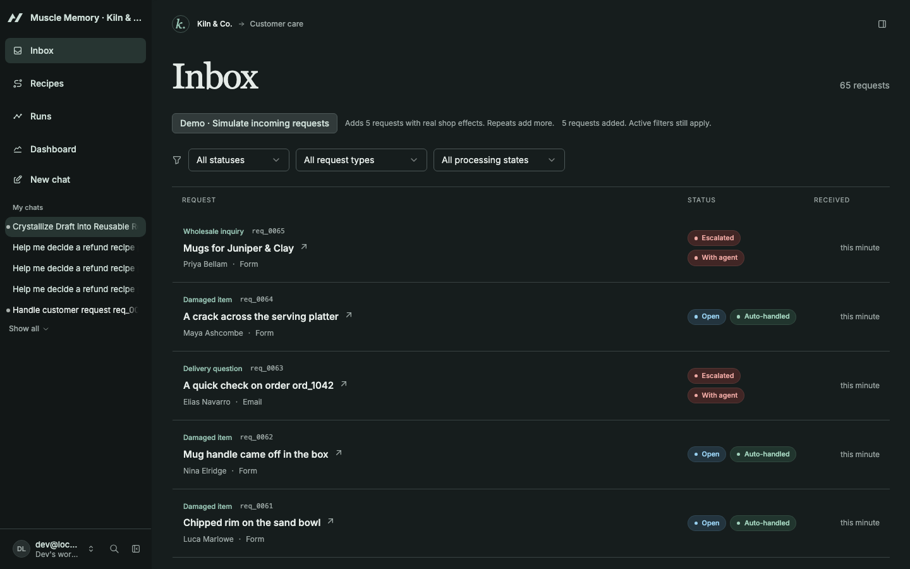
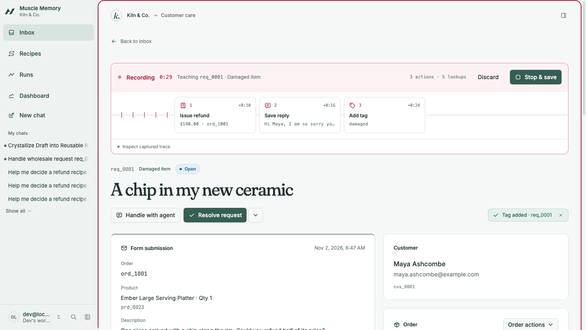
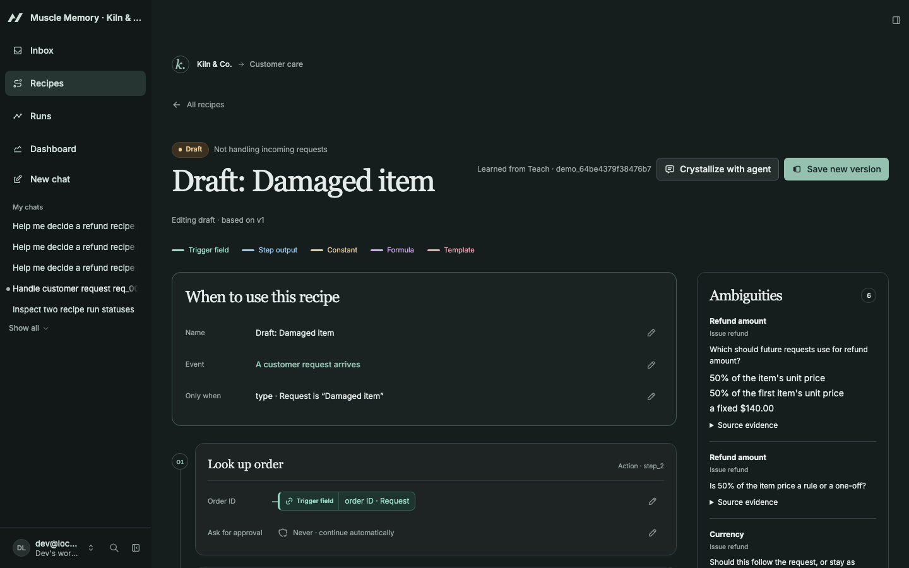
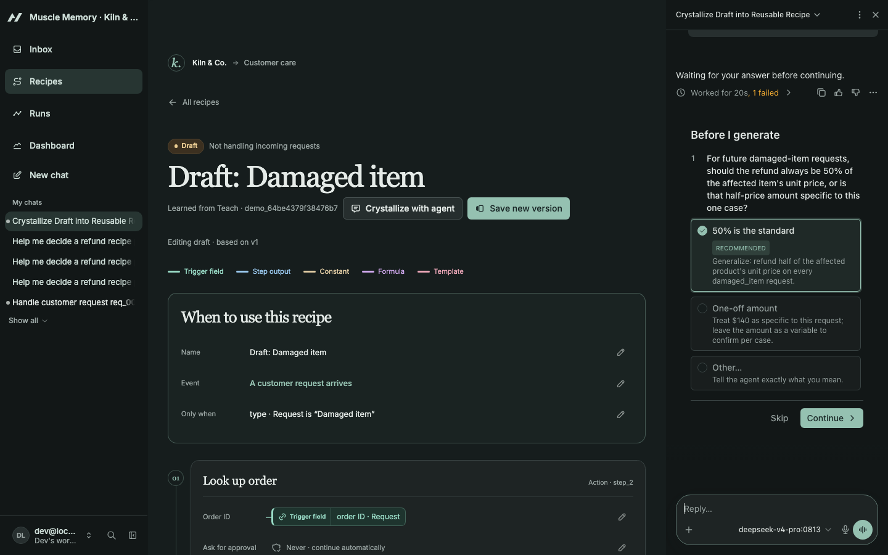
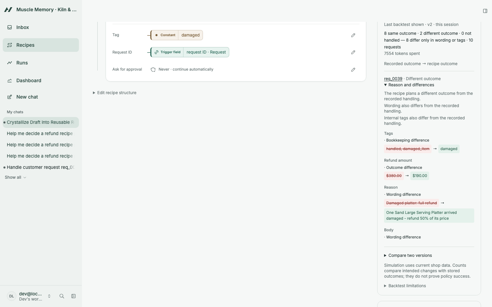
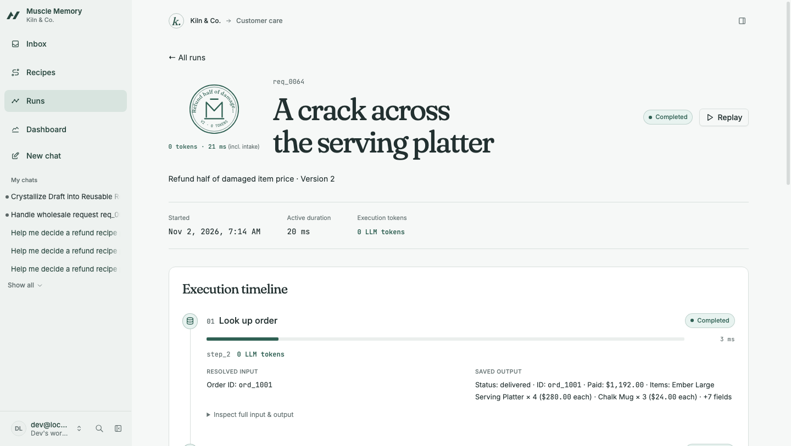
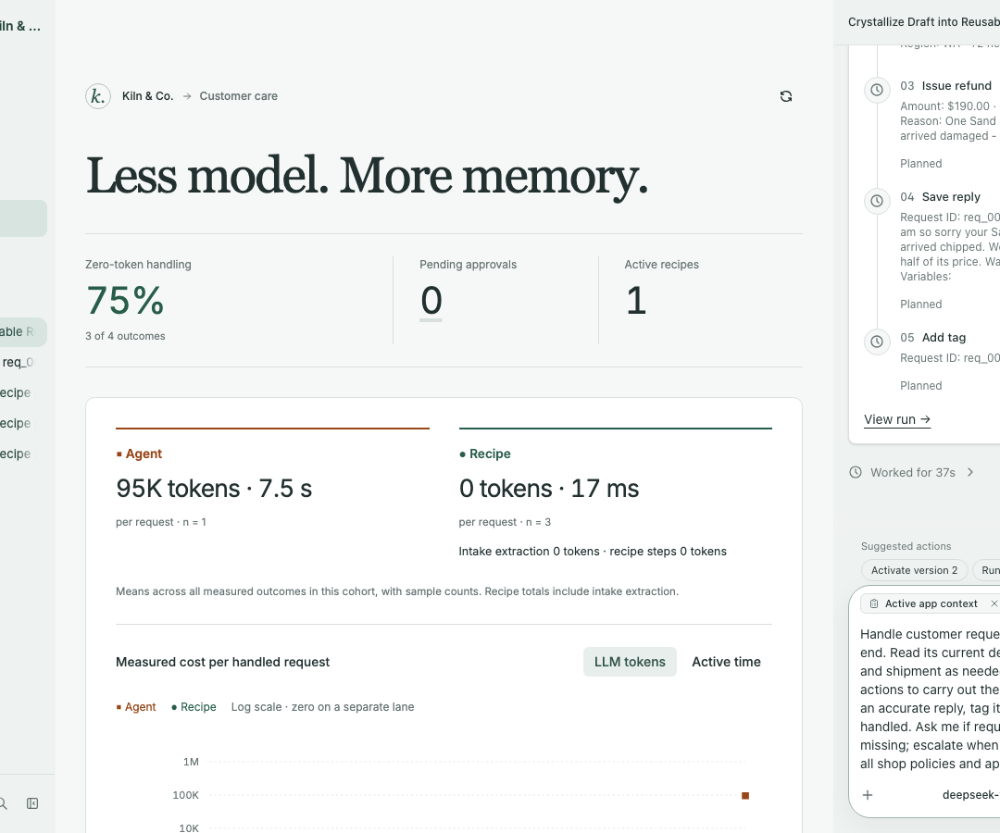
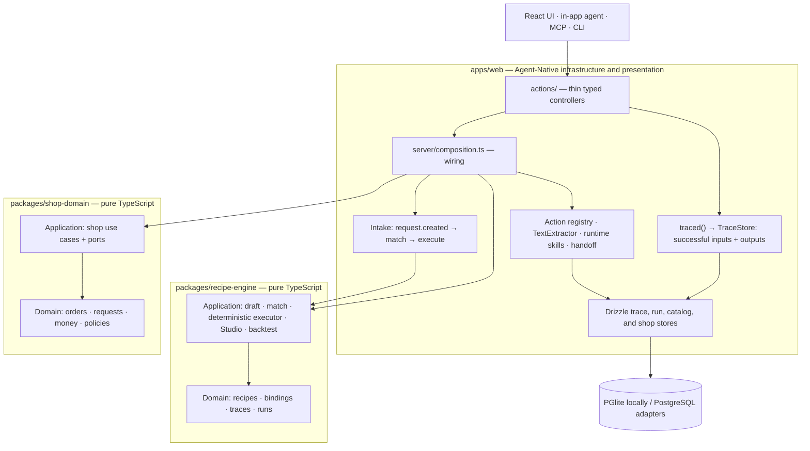

# Muscle Memory

**Show it once. Your app remembers.**

Muscle Memory turns a support operator's work into reusable, deterministic recipes.
In **Kiln & Co.**, a synthetic ceramics shop, handle a request once in Teach mode;
the next matching structured request can run the same workflow with **0 LLM tokens**.
Approval gates keep consequential steps under human control, and unfamiliar work
goes back to the agent.

Built for the Builder.io Agent-Native Hackathon. **Deployment: local only**.

## Problem and idea

Support inboxes repeat the same work: inspect an order, check shipment or policy,
refund a damaged item, reply, and tag the request. Asking an agent to reason through
every repetition spends tokens on decisions the operator has already made.

Agent-Native gives the UI and the agent the same typed actions. Muscle Memory
records those actions with their inputs and results, then turns the demonstration
into an editable program. The operator can see where each argument comes from
before letting it handle another request.

## How it works

1. **Teach:** open a request, start recording, and handle it through the normal UI.
   Successful shop reads and mutations save inputs, outputs, navigation, and timing.
2. **Draft:** code infers provenance “wires” from trigger fields and previous results.
   Bindings can be paths, constants, text templates, or JSONLogic expressions.
   Unused lookups are pruned; uncertain choices are listed for review.
3. **Crystallize:** the agent resolves the remaining ambiguities, asks clarifying
   questions when needed, and names and saves the recipe. Teach, drafting, and
   manual Studio edits do not call a model.
4. **Backtest, then activate:** inspect the wires, conditions, approvals, and version
   diff in Studio. Explicitly backtest a saved version against resolved requests,
   reviewing **same outcome / different outcome / not handled** results. Wording
   and tag differences stay visible without changing the outcome classification;
   a request that cannot be reconstructed from its message is not handled.
   Then choose which immutable version to activate. Backtesting never activates it.
5. **Remember:** intake matches new requests to active versions and the executor
   runs their steps. Structured intake and recipes without extraction use 0 tokens.
   Free-text intake uses a model extraction; recipe `extract` steps also spend tokens.
   Approval gates pause execution. No match, ambiguity, or execution failure can
   hand off the request for agent assistance.

**Learn from corrections.** Operator reply, refund, and tag corrections
within 30 minutes of the latest completed automatic intake run retain the original
and corrected evidence. **Propose recipe update** sends that evidence to the agent,
which saves a proposed version with a diff. The operator explicitly activates it
or rejects it with a recorded reason. Additional refunds are additive shop effects.

**Crystallize an agent run.** After an eligible request is resolved by the
agent, **Crystallize this run** feeds its forward-recorded action trace into the
same draft and Studio pipeline. It does not reconstruct a workflow from chat text.

**Publish without a deploy.** Activation publishes a runtime recipe skill;
deactivation removes it. The agent discovers it on a later turn. MCP and CLI clients
list and execute active recipes through the shared `list-recipes`, `run-recipe`, and
`get-recipe-run` tools. Each recipe is data behind those tools, not a generated tool
implementation. Publication failures leave a visible, retryable receipt.

The dashboard asks **“Less model. More memory.”** Numbers are measured during each
session from actual handling and saved in run and usage records; there are no fixed
demo savings. It shows tokens, active time, zero-token handling, approvals, and
active recipes, with observed agent-versus-recipe comparisons for the same request type.

## Demo video

[`docs/video/muscle-memory-demo.mp4`](docs/video/muscle-memory-demo.mp4) is a 3:47 walkthrough of the real app, recorded live on 2026-11-02: Teach → Recipe Studio → Crystallize with the agent → approval rule and backtest → incoming requests (approve in chat, wholesale handoff) → dashboard → Claude Code running the recipe over MCP.

Slides (10 pages, PDF): [`docs/slides/muscle-memory-slides.pdf`](docs/slides/muscle-memory-slides.pdf).

## Screenshots

| Screen | Screenshot |
| --- | --- |
| Support inbox: who handled each request, at what measured cost |  |
| Teach a request |  |
| Recipe Studio: the recipe drawn as a circuit of binding wires |  |
| Crystallize with the agent |  |
| Historical backtest |  |
| A recipe run: maker's mark and step timings |  |
| Measured AI dependency |  |

## Architecture



The diagram shows calls and wiring. The **import rule** is enforced by
[dependency-cruiser](dependency-cruiser.config.cjs): each domain imports only itself;
application code imports its own application/domain code and Zod. The two pure
packages never import each other or the web app. Framework, database, and model
adapters live in `apps/web`; [composition.ts](apps/web/server/composition.ts) wires
them to use cases. UI code cannot import model SDKs.

Actions validate, call a use case, and map its result. `traced()` wraps shop actions
so Teach and eligible agent runs share a durable trace store, including full
successful results; the framework audit log is only a cross-check. Intake awaits
`request.created` processing and pins a matching immutable version. The executor
resolves bindings, evaluates JSONLogic branches, checkpoints steps, applies recipe
approval gates, and invokes the same action registry. Extraction is isolated behind
the server-side `TextExtractor` port. UI requests for agent help use `sendToAgentChat`.

Implementation details: [engine](packages/recipe-engine/README.md),
[shop](packages/shop-domain/README.md), and
[execution, measurement, and MCP notes](apps/web/server/recipe-execution.md).

## Shared actions

Inventory from the actual [actions directory](apps/web/actions), grouped by purpose.
These actions serve UI, agent, MCP, and CLI callers, subject to their action schemas
and caller context. Core also supplies framework tools outside this directory.

| Group | Action | Purpose |
| --- | --- | --- |
| Shop | `list-requests` | Filter the support inbox. |
| Shop | `get-request` | Read original content, state, related IDs, and corrections. |
| Shop | `get-request-activity` | Read persisted replies, refunds, replacements, labels, and recorded state. |
| Shop | `get-customer` | Read a synthetic customer and address book entry. |
| Shop | `get-order` | Read purchased items, payment, address, and return label. |
| Shop | `get-shipment-status` | Read shipment and tracking information. |
| Shop | `create-request` | Create structured or free-text intake and await processing. |
| Shop | `demo-intake` | Inject scripted requests through real intake; repeated calls create more effects. |
| Shop | `list-request-processing` | Read intake state, run linkage, match reason, and token usage. |
| Shop | `issue-refund` | Refund an order subject to shop policy and caller approval. |
| Shop | `create-replacement-order` | Create an unshipped replacement at no extra charge. |
| Shop | `update-shipping-address` | Change an order address before dispatch. |
| Shop | `generate-return-label` | Record a synthetic label within the return window. |
| Shop | `send-reply` | Save a demo reply using text/template variables. |
| Shop | `tag-request` | Add a trimmed, deduplicated tag. |
| Shop | `set-request-status` | Set open, pending, or resolved status. |
| Shop | `escalate` | Record a reason and escalate the request. |
| Teach | `start-demonstration` | Start recording the request in the current operator tab. |
| Teach | `stop-demonstration` | Save the trace, marking unfinished captures incomplete. |
| Teach | `cancel-demonstration` | Cancel recording and free the slot; shop effects remain. |
| Teach | `get-demonstration` | Read an owned trace with ordered inputs, outputs, navigation, and timing. |
| Teach | `get-agent-run-demonstration` | Read an eligible completed agent trace for crystallization. |
| Recipes / Studio | `draft-recipe-from-demonstration` | Infer and save a draft plus ambiguity evidence without a model. |
| Recipes / Studio | `get-recipe` | Inspect catalog metadata, immutable history, diffs, and corrections. |
| Recipes / Studio | `get-recipe-draft` | Read original draft evidence or current editable Studio content. |
| Recipes / Studio | `update-recipe-draft` | Replace editable content with optimistic revision checks. |
| Recipes / Studio | `save-recipe-version` | Validate and save an immutable version, optionally linking a proposal. |
| Runs | `run-recipe` | Execute or dry-run an immutable recipe with a trigger. |
| Runs | `resume-recipe-run` | Approve/reject a gate or explicitly retry eligible failed work. |
| Runs | `get-recipe-run` | Read checkpoint, attempts, metrics, approvals, handoff, and corrections. |
| Runs | `list-recipe-runs` | Filter saved runs with version, status, timing, and execution tokens. |
| Backtest | `backtest-recipe` | Simulate a version against resolved requests of a selected type. |
| Backtest | `compare-recipe-versions` | Compare two versions against one shared historical cohort. |
| Corrections | `record-correction-decision` | Reject a pending proposal with a reason; acceptance uses activation. |
| Registry | `list-recipes` | Discover catalog entries and their active immutable snapshots. |
| Registry | `activate-recipe` | Select a saved version, accept linked corrections, and publish its skill. |
| Registry | `deactivate-recipe` | Clear future intake activation and remove the runtime skill. |
| Registry | `retry-recipe-skill` | Retry discovery synchronization for the current active pointer. |
| Stats | `get-handling-stats` | Read measured handling outcomes, coverage, and comparisons. |
| Shell / template | `navigate` | Request navigation through application state. |
| Shell / template | `view-screen` | Read the current screen and fresh selected-record context. |
| Shell / template | `hello` | Return the starter greeting. |
| Shell / template | `provider-api-request` | Retained template Slack API bridge; requires a connected workspace. |

`actions/run.ts` is the script-runner bootstrap, not a registered action.

## Run locally

Prerequisites: **Node ≥ 22.22** and **pnpm** (the workspace pins **12.16.1**).
Run all commands below from the **repository root**, one directory above this README.

```sh
pnpm -C src install
```

Copy [apps/web/.env.example](apps/web/.env.example) to `src/apps/web/.env` and fill
it locally. Keep secrets in this gitignored file. Its variable names are:

| Variables | Use |
| --- | --- |
| `AGENT_ENGINE`, `AGENT_MODEL` | In-app agent provider mode and model selection. |
| `OPENAI_BASE_URL`, `OPENAI_API_KEY` | Ollama Cloud's OpenAI-compatible endpoint and your credential. |
| `EXTRACT_MODEL` | Separate free-text / recipe extraction model. |
| `AUTH_DISABLED` | Optional local authentication override. |
| `BETTER_AUTH_SECRET`, `BETTER_AUTH_URL` | Authentication configuration. |
| `DATABASE_URL` | Optional database override; local development defaults to PGlite. |

Select the OpenAI-compatible provider mode and the Ollama Cloud endpoint described
in the example's comments, with the model IDs in the table below. Chat and free-text
extraction need provider configuration. Teach, structured deterministic execution,
and the normal tests can run without a model credential. Local PGlite needs no
external database; use the development sign-in flow when authentication is enabled.

With the dev server stopped, seed the shop, then start it:

```sh
pnpm -C src seed:shop
pnpm -C src dev
```

Open the local URL printed by the server and go to `/inbox`. Seeding applies app
migrations and replaces shop data plus related demonstrations, intake, corrections,
and runs. It preserves the recipe catalog and versions by default. Content is
repeatable; timestamps anchor to the current seeding minute. For a pristine rehearsal
that also clears recipe catalog entries, versions, and all runs, stop the server and use:

```sh
pnpm -C src seed:shop --all
```

Deactivate active recipes first if you also want their published runtime skills
removed; the maintenance reset itself does not unpublish resource skills.

### Backtest rehearsal

With the server stopped, prepare the shop and the explicitly authored fixture recipe:

```sh
pnpm -C src seed:shop
pnpm -C src/apps/web exec tsx scripts/seed-backtests.ts
pnpm -C src dev
```

Open `/recipes/recipe_backtest_damaged`, **Seeded damaged item: half refund**, select
saved v1, and click **Run backtest**. The script saves a draft catalog entry and an
immutable fixture version; it does not activate it or demonstrate recipe learning.
The historical cohort includes free text, so configure extraction first. Backtests
and comparisons may spend tokens; the result reports usage. Inspect the observed
outcome diffs before activation. Rehearsal numbers and the detailed procedure are
documented in [server/recipe-execution.md](apps/web/server/recipe-execution.md#reproduce-a-studio-backtest-on-the-seed).

### Tests and checks

```sh
pnpm -C src typecheck
pnpm -C src test
pnpm -C src e2e
pnpm -C src lint
pnpm -C src lint:arch
pnpm -C src build
```

Tests use in-memory ports, fake extractors, UI components, and PGlite integration;
they never call a real LLM. The test command also runs architecture regressions.
The e2e suite covers Teach → Studio → activation → zero-token automatic handling
and Dashboard using an isolated seeded database; it needs local Chrome or Chromium
and permission to launch browser processes.
The build produces local artifacts. Without production authentication and persistent
PostgreSQL configuration, Core prints production-configuration errors even though
the build exits successfully; a successful build alone does not establish deployment readiness.

## Pre-existing vs built during the hackathon

**Pre-existing foundation:** the bundled Agent-Native **chat** template from
`@agent-native/core` **0.222.2**, recorded in the web package's scaffold metadata.
Core, Toolkit, and AgentKit are installed at 0.222.2. The template supplied the
chat shell, threads, authentication, navigation, sync, action plumbing, and library
components. These are credited as framework/template work.

**Built from 2026-11-02 onward:** application-specific code under `src/` implements
the synthetic shop, inbox/request workspace, Teach and agent traces, provenance
inference, recipe DSL and Studio, deterministic execution/intake, approvals and
handoffs, corrections, backtests, runtime skill registry, measured dashboard, and
their tests and rehearsal scripts. The earliest commit touching `src/` is
**2026-11-02 00:17:06 +0300**, verified from git history. This date describes repository
development, not the creation date of the bundled template or its dependencies.

Key pinned versions, verified against package manifests, `pnpm-lock.yaml`, and
installed packages:

| Library / tool | Version | Role |
| --- | --- | --- |
| `@agent-native/core`, `@agent-native/toolkit`, `@agent-native/agentkit` | 0.222.2 | Framework and template. |
| React / React DOM | 19.3.1 | UI rendering. |
| React Router | 8.5.1 | Routing and app build integration. |
| `drizzle-orm` | 0.45.4 | Persistence adapters. |
| `@electric-sql/pglite` | 0.5.14 | Local PostgreSQL-compatible storage and integration tests. |
| Zod | 4.6.7 | Boundary and recipe validation. |
| Vitest | 5.0.5 | Unit, component, and integration tests. |
| TypeScript | 7.0.2 | Strict typechecking. |
| Oxlint | 1.90.0 | Linting. |
| dependency-cruiser | 18.7.0 | Import-boundary enforcement. |
| `@fontsource-variable/inter` | 5.3.0 | Packaged font. |
| `@fontsource-variable/fraunces` | 5.3.0 | Bundled variable display font; OFL-1.1. |
| `@fontsource-variable/jetbrains-mono` | 5.3.0 | Bundled variable data font; OFL-1.1. |
| `@tabler/icons-react` | 3.50.0 | Packaged icons. |
| Playwright / `@playwright/test` | 1.64.1 | Browser e2e regression tests. |

**Assets:** third-party assets comprise the template defaults and the packaged fonts and icons credited above. All tracked
public SVG logos, favicons, and app icons match the bundled chat template; typography
and UI icons come from the packages credited above. Shop content is synthetic.
The screenshot references are for captures of this app supplied during review.

Planning notes and hackathon research (`docs/source/` in the private working
repository) are not application code and are not included in this public repository.

## AI tools and models

**Development:** OpenAI Codex CLI (**gpt-6.1-sol**) wrote code from task work orders.
Claude Code (**Claude Opus 5.5**) planned the work, wrote tasks, reviewed every accepted change,
ran browser verification, and merged accepted work. Backlog task records preserve
implementation and review evidence; this README change remains subject to review.

**In the app:** both models use Ollama Cloud's OpenAI-compatible API.

| Role | Model | When used |
| --- | --- | --- |
| In-app agent | `deepseek-v4-pro:0813` | Unfamiliar requests, ambiguity review, crystallization, and proposed revisions. |
| Free-text extraction | `glm-5.3-flash` | Validated intake fields and explicit recipe extraction steps, including backtests. |
| Deterministic recipe path | None | Structured matching, bindings, branches, and action execution need no model. |

**Demo video:** Claude Code recorded it by driving the running app in headless Chrome with real clicks and the live model. A drawn pointer marks where each click lands. Waits for the model and idle pauses are cut; nothing is re-staged or sped up. The narration is synthetic speech from Ollama Phonon (voice "Easton"). The terminal shot is a real Claude Code session calling the app's MCP tools.

Selection evidence and its scope: [Ollama benchmark](benchmarks/ollama-2026-11-01.md).
Its filename uses UTC; the measurements were taken on 2026-11-02 in Moscow.

## Known limitations

- **Demo shop:** all customers and transactions are synthetic. Replies are stored,
  not emailed; return labels do not purchase carrier services.
- **One demonstration per recipe:** inferred bindings require ambiguity review.
  Incomplete traces cannot be drafted. Agent crystallization requires a complete,
  eligible recorded resolution; there is no historical chat backfill.
- **Current-state backtests:** historical inputs/outcomes are compared with reads
  from current shop data, not time-travel snapshots. Results distinguish same
  outcome, different outcome, and not handled; wording/tag differences remain
  visible but do not change the outcome. Requests that cannot be reconstructed
  from their messages, or whose simulated runs are blocked by missing mutation
  outputs, are not handled.
  A backtest is advisory and does not gate activation.
- **Measured cost has boundaries:** the dashboard uses the latest 100 recorded
  handling outcomes, which can span sessions. Seed history, manual/unlinked
  resolutions, dry runs, queued handoffs, and pending approvals are excluded.
  Recipe totals include intake extraction and execution; active time excludes
  approval waits. Unknown extraction usage stays unknown. These are token/time
  observations, not dollar savings estimates; late trace writes may need a refresh.
- **Agent attribution:** within your owner/workspace, costs include full turns from
  the first request action through resolution, plus prior intake/recipe work; each
  run counts once. Reads, questions, and intervening chat count too. Shared or
  overlapping work, missing or placeholder-zero traces, and external agents without
  local usage remain unmeasured.
- **Handoff needs an operator:** it durably queues context and escalates the request;
  it does not automatically start a chat turn. The UI stages agent help through chat.
- **Local MCP authentication:** the loopback `/mcp` endpoint requires the
  `X-Agent-Native-Owner-Email` header for the local owner context; a bare request is
  unauthorized. Do not treat the local development header as production authentication.
- **Local only:** production deployment is unfinished. PGlite supports one
  database-owning process; stop dev before running seed/rehearsal scripts.
